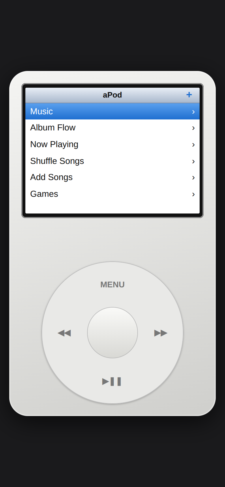
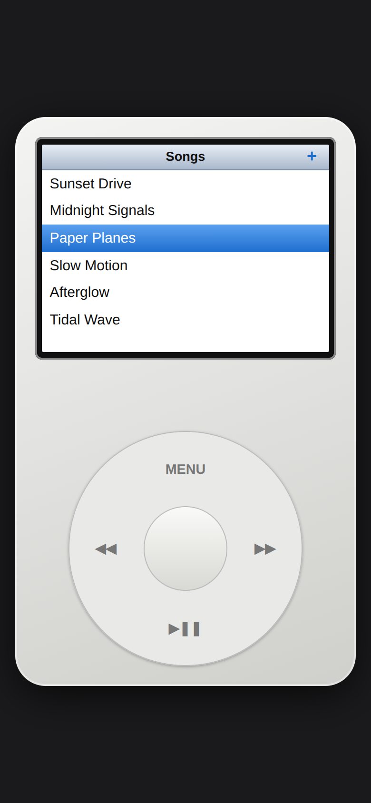
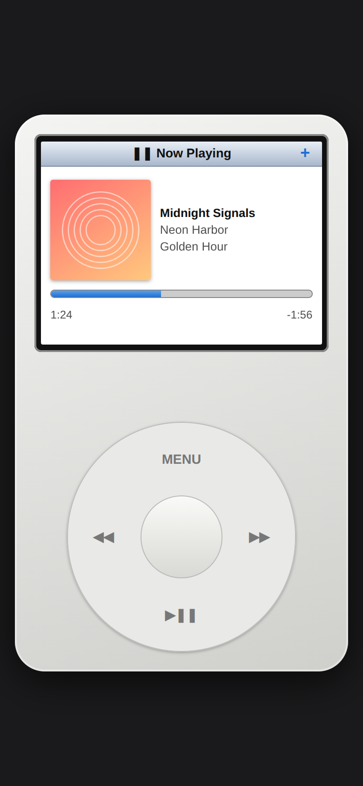
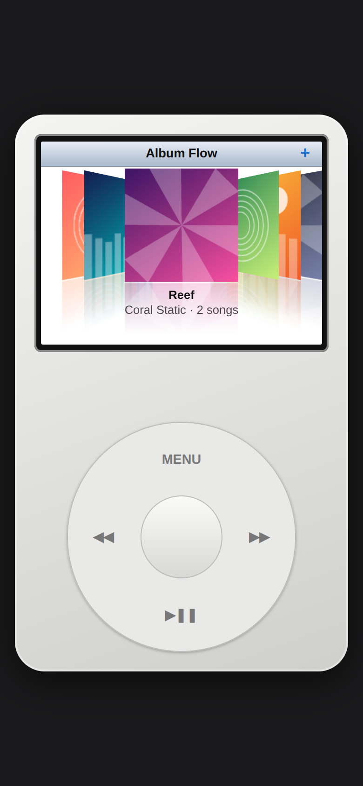
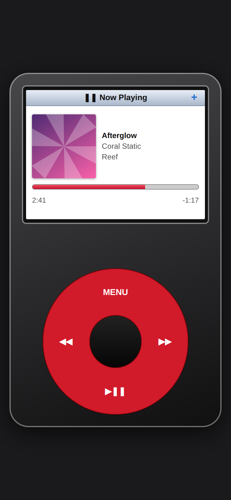
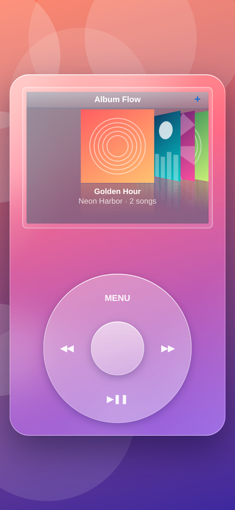
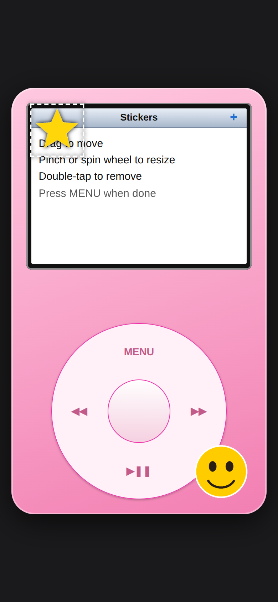
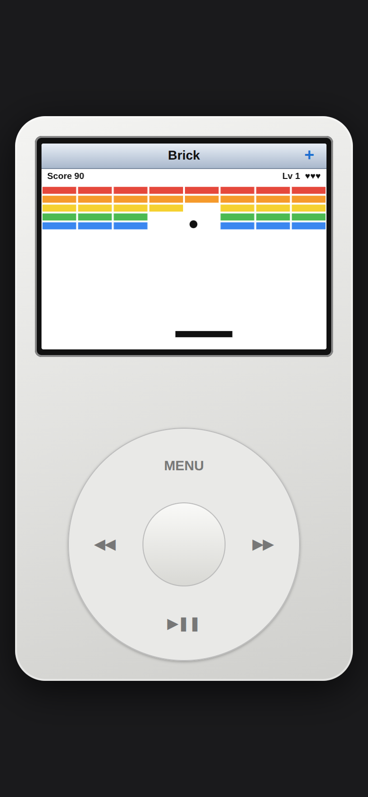
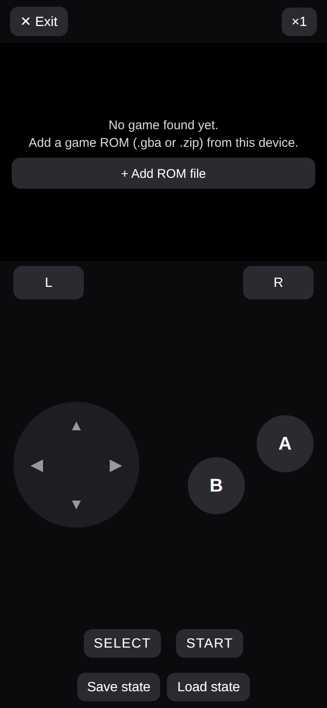

# aPod

An offline music player with a retro click-wheel look, built as a web app and packaged for Android and iPhone with [Capacitor](https://capacitorjs.com/). Everything runs on your device. No account, no internet needed after install.

**Features:** music library with cover art and track info, Album Flow (cover browser), playlists (`.m3u`/`.m3u8`/`.pls`), duplicate removal, 6 themes, custom background, movable stickers, a Brick game, and a built-in GBA emulator (bring your own games).

> aPod is an independent project. It is not affiliated with, endorsed by, or sponsored by Apple Inc. All trademarks belong to their owners.

---

## Screenshots

<table>
<tr><td align="center"> Main menu</td><td align="center"> Songs</td><td align="center"> Now Playing with cover art</td></tr>
<tr><td align="center"> Album Flow</td><td align="center"> Red theme</td><td align="center"> Glass theme + custom background</td></tr>
<tr><td align="center"> Stickers</td><td align="center"> Brick game</td><td align="center"> GBA emulator controls</td></tr>
</table>

Screenshots use generated sample songs and artwork.

---

## Install on Android

Works on Android 5.1 and newer.

1. On your phone, open the **[Releases](../../releases)** page and download **`apod.apk`** from the latest release.
2. Open the downloaded file.
3. If asked, allow **Install unknown apps** for your browser or file manager, then go back and tap **Install**.
4. If Play Protect warns you, tap **Install anyway**. This warning appears for any app that isn't from the Play Store.
5. Open **aPod**.

**Updating:** download the newest `apod.apk` and install it over the old one. Your songs stay.

---

## Install on iPhone

Apple doesn't allow installing apps outside the App Store without signing them, so you sideload `apod.ipa` with a free tool. You need a computer (Windows or Mac) and a USB cable.

### Option A: Sideloadly (simplest)

1. Download **`apod.ipa`** from the **[Releases](../../releases)** page onto your computer.
2. Install [Sideloadly](https://sideloadly.io/) on your computer.
3. Plug in your iPhone and tap **Trust** if it asks.
4. Drag `apod.ipa` into Sideloadly, enter your Apple ID, and click **Start**.
5. On the iPhone, open **Settings > General > VPN & Device Management**, tap your Apple ID, and tap **Trust**.
6. On iOS 16 and newer, also turn on **Settings > Privacy & Security > Developer Mode**, then restart when asked.
7. Open **aPod**.

### Option B: AltStore

Install [AltStore](https://altstore.io/), then open `apod.ipa` with AltStore on your phone. AltStore can refresh the app automatically in the background while your computer is on the same Wi-Fi.

### Things to know

- With a **free Apple ID**, the app expires after **7 days**. Re-run Sideloadly (or let AltStore refresh it) to renew it. Your songs stay. The limit is 3 sideloaded apps.
- A paid Apple Developer account ($99/year) extends this to one year.
- Use an Apple ID you're comfortable with. Sideloadly sends it to Apple, not to the app.

---

## Using the app

### Adding music
- Tap the **+** at the top right of the screen, or go to **Add Songs** in the menu, and pick audio files (MP3, M4A, AAC, WAV, FLAC).
- **iPhone:** save your music to the **Files** app first, because that's where the picker looks.
- Cover art, title, artist, album and track number are read from MP3 tags.
- Duplicates are skipped automatically, and existing ones are cleaned up on launch.

### Controls
| Control | Action |
|---|---|
| Drag around the wheel | Scroll (seek in Now Playing) |
| Center button | Select |
| MENU | Back |
| ◀◀ / ▶▶ | Previous / next |
| ▶❚❚ | Play / pause |
| Tap a row | Select it directly |

### Library
- **Music > Songs, Playlists, Album Flow.** In Album Flow, press the center button on an album to see its tracks. Switch to one-cover-per-song in **Settings > Album Flow**.
- **Playlists:** add `.m3u`, `.m3u8` or `.pls` files the same way as songs. Entries are matched to your songs by file name or title, so add the songs and the playlist in any order.

### Customise (Settings)
- **Theme:** six looks, including Glass.
- **Background:** pick any image from your phone.
- **Stickers:** add images (transparent PNGs work best), drag to move, pinch or spin the wheel to resize, double-tap to remove.

### Games
- **Brick:** spin the wheel to move the paddle, center button to launch.
- **GBA:** a built-in Game Boy Advance emulator. **No games are included.** Choose **+ Add ROM file** and pick a game file (`.gba`, or a `.zip` containing one) that you own. It's stored only on your device. Use the on-screen buttons, and **Save state / Load state** to save progress. In-game saves are kept automatically.

---

## Building it yourself

The app is a single web page in `www/index.html` plus the emulator in `www/emu/`.

1. Fork or push this repo to GitHub.
2. The workflows in `.github/workflows` build `apod.apk` (Android) and `apod.ipa` (iOS, unsigned) on every push.
3. To publish a release, push a tag starting with `v` (for example `v1.8.0`). Both files are attached to a release automatically.

Local build: `npm install`, then `npx cap add android` / `npx cap add ios`, `npx cap sync`, and build with Android Studio or Xcode.

---

## Credits and licenses

- GBA emulation: [mGBA](https://mgba.io/) (MPL-2.0), compiled to WebAssembly by [thenick775](https://github.com/thenick775/mgba). See `www/emu/NOTICE.txt`.
- App shell: [Capacitor](https://capacitorjs.com/) (MIT).
- You are responsible for only using music, games and images you have the rights to use.
