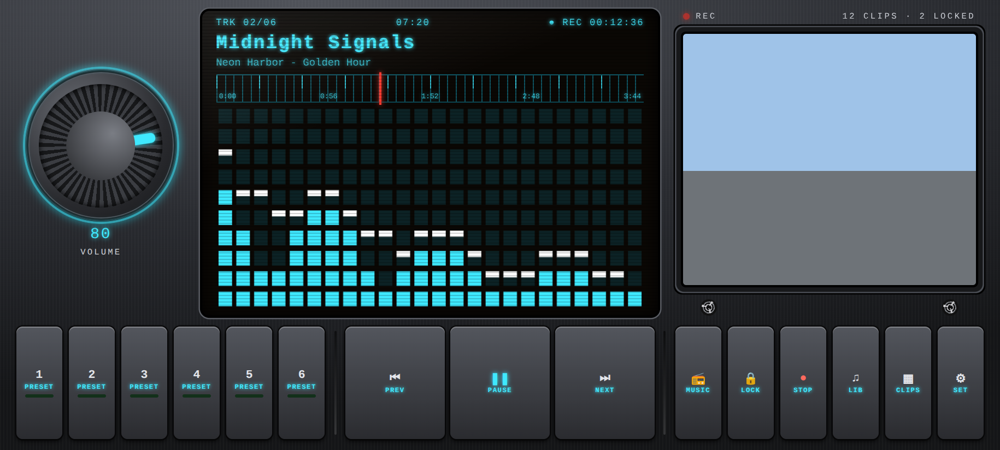
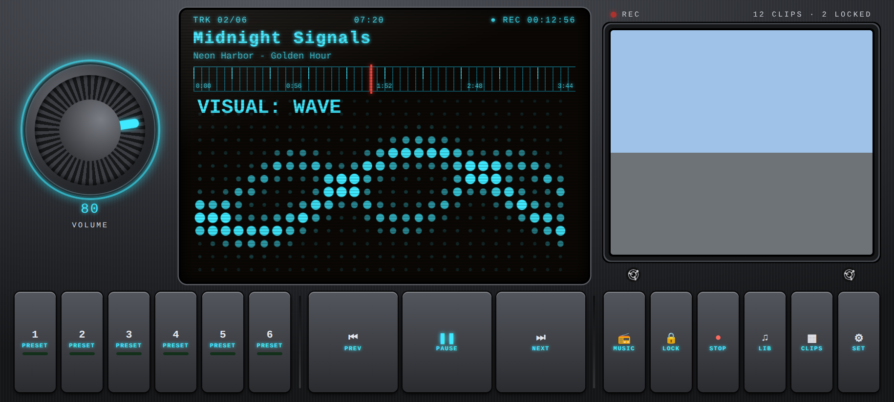
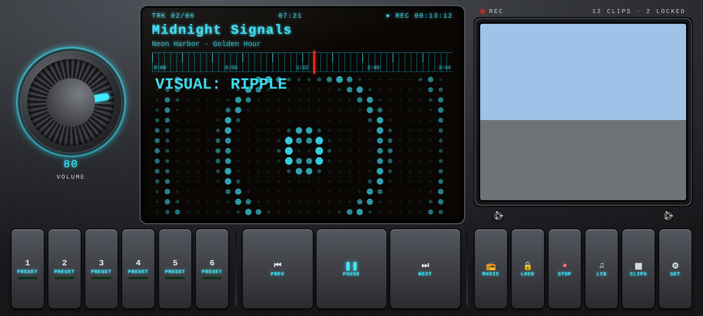
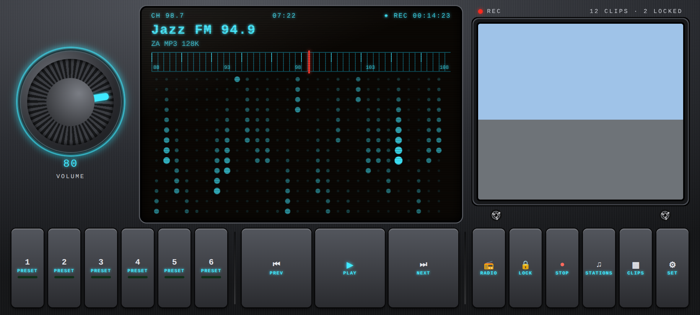
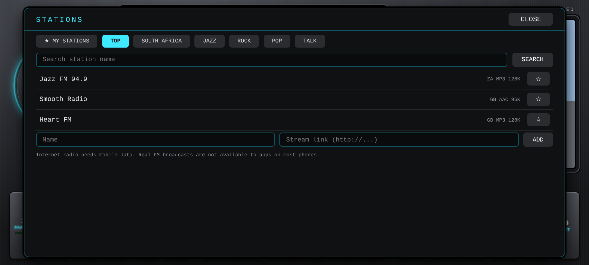

# DriveDeck (Android)

A dash cam, music player and internet radio in one app, styled like a 2000s car stereo. Android only.

## Screenshots

<table>
<tr>
<td align="center"> Main screen: live camera window, spectrum, glowing knob</td>
<td align="center"> Dot-matrix "wave" visual</td>
</tr>
<tr>
<td align="center"> "Ripple" visual</td>
<td align="center"> Radio mode with tuner dial</td>
</tr>
<tr>
<td align="center"> Station browser</td>
<td align="center"> Clips list</td>
</tr>
</table>

Rendered in a browser with sample data. The camera window shows a placeholder here.

## Features

- **Dash cam:** loop recording in short clips (1, 3 or 5 minutes). The oldest unlocked clips are deleted when your storage cap is reached.
- **Impact lock:** the motion sensor locks the current clip and the one before it when it feels a hard impact. A LOCK button does the same by hand. Locked clips are never auto-deleted. The display flashes "IMPACT LOCKED" in red.
- **Live camera** shows in the cassette window while music or radio plays.
- **Animated dot-matrix display:** tap the display to switch between LED bars, wave, ripple, rain and tunnel visuals, or leave it on AUTO. The visuals react to the music. The display also scans on at start-up and shows static while tuning.
- **Glowing volume knob** that pulses with the bass, and green preset lights.
- **Music:** plays songs stored on the phone. 6 presets (hold a preset to store the current song).
- **Internet radio:** press **MUSIC/RADIO** to switch source. Browse stations (top, South Africa, jazz, rock, pop, talk), search by name, add your own stream link, and star favourites. Prev/Next step through your favourites, and presets store stations in radio mode. A tuner dial needle sweeps to each station.
- **Backlight colours:** cyan, blue, amber, green, ice, red.

## Install

Download `drivedeck.apk` from the **Releases** page (tags starting with `dd-v`), open it, and allow installs from unknown sources.

## Notes

- **Radio is internet radio** and needs mobile data. Station listings come from the free community directory [radio-browser.info](https://www.radio-browser.info/). Real FM/AM broadcasts are not available to apps on most phones.
- The phone must be firmly mounted. It is illegal in many places, including South Africa, to hold a phone while driving. Start recording before you drive.
- Recording keeps going if you switch apps or turn the screen off (Android shows a notification while it records).
- Microphone recording is **off** by default. If you turn it on, tell your passengers.
- Footage can contain personal information. Be careful before sharing it online.
- Clips are saved in the app's `Movies/DriveDeck` folder. Use **SAVE** in the clips list to copy one to your gallery.
- Inspired by classic car stereos. Not affiliated with any audio brand.
