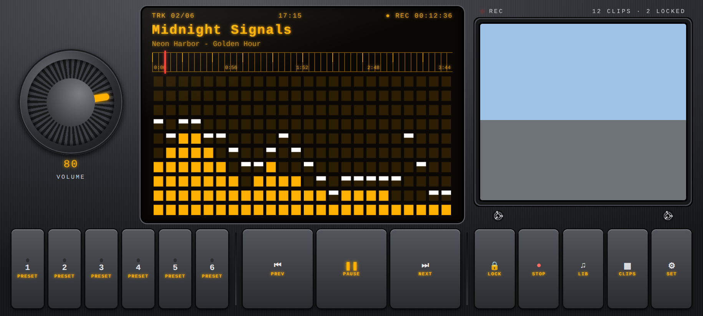
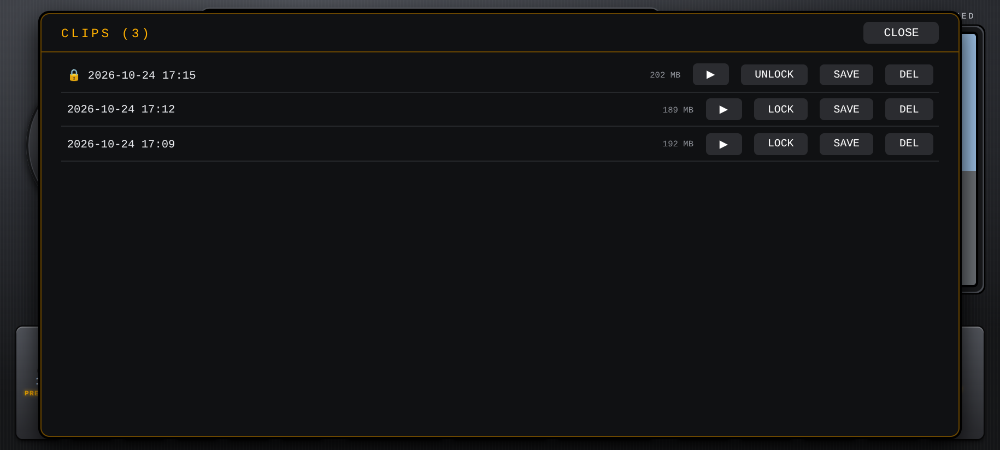
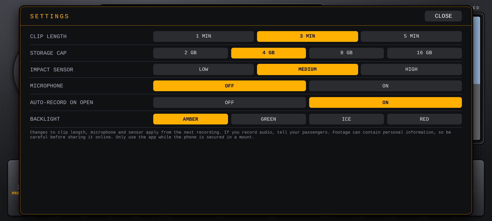
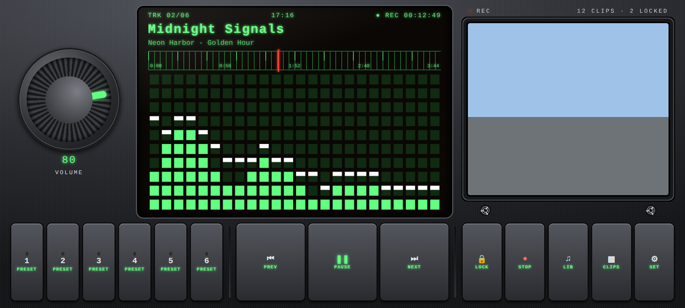

# DriveDeck (Android)

A dash cam and music player in one app, styled like a 1970s/80s car stereo. Android only.

- **Dash cam:** loop recording in short clips (1, 3 or 5 minutes), oldest clips are deleted when your storage cap is reached.
- **Impact lock:** the phone's motion sensor locks the current clip (and the one before it) when it detects a hard impact. A LOCK button does the same by hand. Locked clips are never auto-deleted.
- **Live camera** shows in the cassette window while the music plays.
- **Music:** plays songs stored on the phone, with an amber spectrum display, an analog-style dial that tracks the song, 6 presets (hold a preset to store the current song), and a volume knob.
- **Backlight colours:** amber, green, ice, red.

## Screenshots

<table>
<tr><td align="center"> Main screen: amber display, spectrum, live camera window</td><td align="center"> Clips list</td></tr>
<tr><td align="center"> Settings</td><td align="center"> Green backlight</td></tr>
</table>

Rendered in a browser with sample data. The camera window shows a placeholder here.

## Install

Download `drivedeck.apk` from the **Releases** page (tags starting with `dd-v`), open it, and allow installs from unknown sources.

## Notes

- The phone must be firmly mounted. It is illegal in many places, including South Africa, to hold a phone while driving. Start recording before you drive.
- Recording keeps going if you switch apps or turn the screen off (Android shows a notification while it records).
- Microphone recording is **off** by default. If you turn it on, tell your passengers.
- Footage can contain personal information. Be careful before sharing it online.
- Clips are saved in the app's `Movies/DriveDeck` folder. Use **SAVE** in the clips list to copy one to your gallery.
- Inspired by classic car stereos. Not affiliated with any audio brand.
